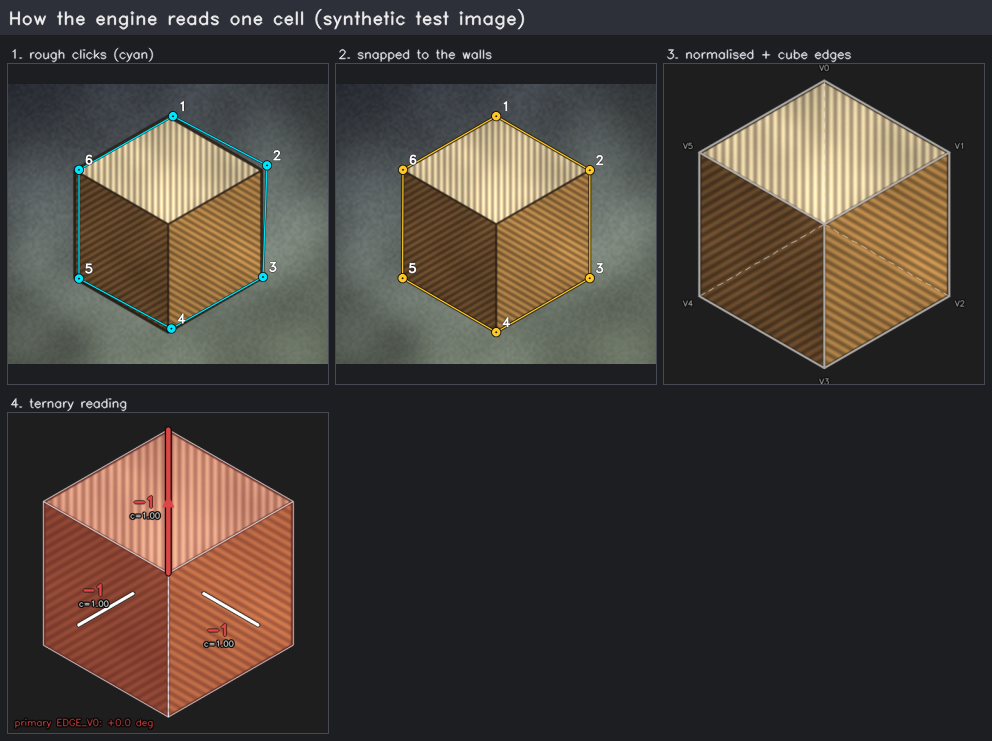
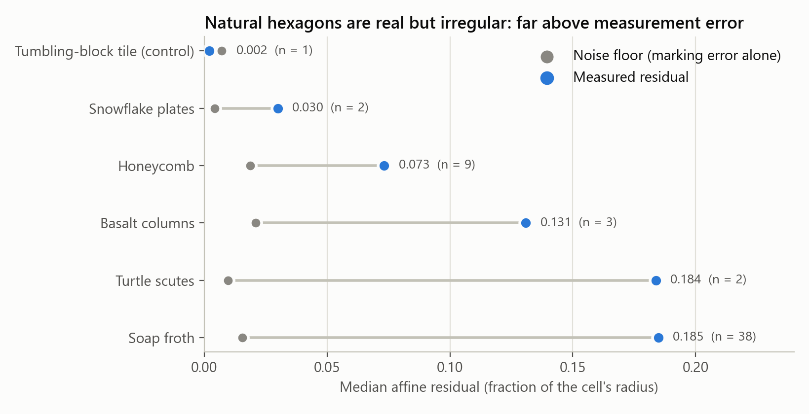
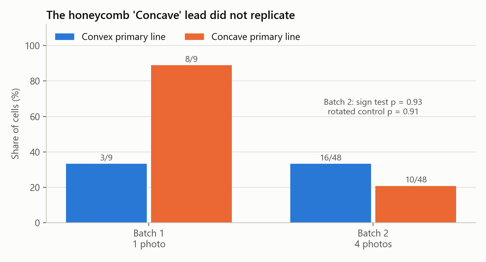
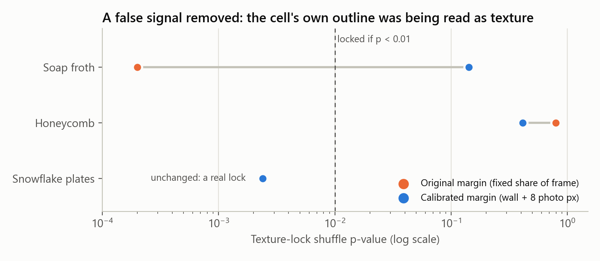
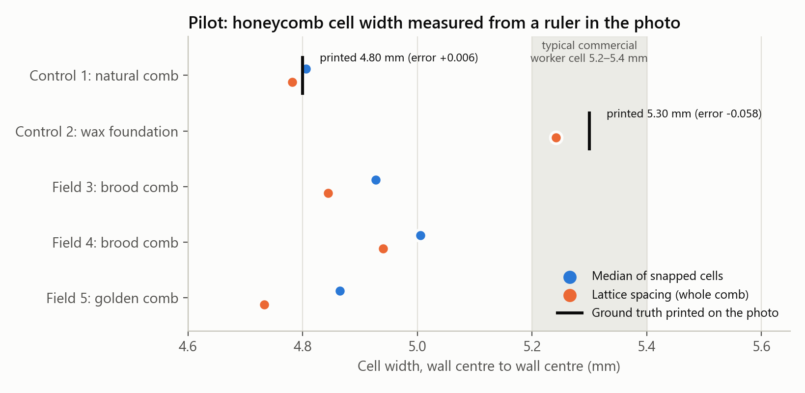

# What a hexagon can and can't tell you: testing a geometric idea against nature

*Clare Rudling, with Ben · 25 November 2026*
*Engine built with Claude (Anthropic). Specification drafted with Grok (xAI); test images sourced with Google's Gemini (AI Mode).*

> **Published** on Substack on 25 November 2026 and shared on other media: [https://clare539454.substack.com/p/what-a-hexagon-can-and-cant-tell](https://clare539454.substack.com/p/what-a-hexagon-can-and-cant-tell). Reviewed by Grok and Gemini before publication.

---

## The idea

Hexagons turn up all over nature: honeycomb, basalt columns, soap froth, turtle shells, snowflakes. A regular
hexagon is also what you see when you look at a cube straight down one corner. That raised a question we wanted to
answer properly: **are natural hexagons secretly "cube silhouettes"?** If they were, the texture inside each cell
might carry a hidden three-dimensional reading. That reading would have a Necker orientation (the cube seen popping
out or sinking in), a ternary state (+1 / 0 / −1) along each of the cube's edges, and lines that carry on from one
cell into the next.

That is a testable claim, so we built a machine to test it. And we let it say no.

## The engine

The Hexagonal Geometric Test Engine is a Python / Streamlit app that runs in Docker on a home PC. For each cell:

1. **Mark six corners.** Rough clicks are enough, because the engine **snaps them to the cell walls** to sub-pixel
   precision by fitting straight lines along each wall.
2. **Normalise.** It fits the six corners to a perfect hexagon by three methods (affine, perspective/homography and
   similarity) and records how far the real cell is from perfect.
3. **Compare with a noise floor.** It works out how imperfect a *truly perfect* hexagon of the same size would look,
   given the corner error alone. A shape counts as irregular only if it sits clearly above that floor.
4. **Read the texture.** A structure-tensor orientation field (Bigün & Granlund, 1987) gives the dominant line
   direction in each region. That direction is then read against the cube's edges as +1, 0 or −1.
5. **Use controls throughout.** A tumbling-block tile (a real drawing of cubes) calibrates the reading. Rotation and
   shuffle tests check whether any pattern beats chance, and every lead must replicate on new photographs.

*Figure 1. One cell through the pipeline, on a synthetic image we generated: rough clicks, corners snapped to the
walls, the cell normalised with the cube's edges drawn in, and the ternary reading.*

## What we tested

* **Batch 1:** 21 photographs in six groups (tumbling-block tiles as the control, honeycomb, basalt, soap froth,
  turtle scutes and snowflakes), 55 cells that passed the quality gate.
* **Batch 2:** 12 new photographs chosen specifically to test the leads from Batch 1, including 48 honeycomb cells
  from four photos.
* **Pilot:** five honeycomb photographs with a ruler in the frame, to see whether the engine can measure real cells
  in millimetres.

## Finding 1: natural hexagons are real, but they are not cube silhouettes

A cube silhouette is a regular hexagon seen in perspective, so after the right normalisation it should fit almost
perfectly. The control tile does: its residual (0.002 of the radius) sits below its own noise floor. **No natural
group does.** Honeycomb, basalt, turtle scutes and froth are all far above their noise floors. Most also fail central
symmetry (opposite sides parallel and equal), which any projected regular hexagon must pass. They are genuinely
six-sided, but irregular in ways a projected cube cannot be. Snowflake plates come closest, as crystal physics would
predict.

*Figure 2. Blue: how far each group's cells are from a perfect hexagon after normalisation. Grey: what corner error
alone would produce. Only the control tile sits on its floor.*

## Finding 2: the honeycomb "Concave" lead did not replicate

Batch 1 produced an exciting hint: 8 of 9 honeycomb cells gave a Concave primary line. But all nine came from one
photograph. Batch 2 tested 48 cells from four new photographs and found 10 Concave and 16 Convex: no preference at
all (sign test p = 0.93; a rotated-texture control gives the same answer, p = 0.91). A "concentric across-the-edges"
signature seen in four Batch 1 snowflake cells also failed: 0 of 2 Batch 2 plates showed it.

*Figure 3. A single-photo lean (left) disappeared when the sample grew to 48 cells from four photographs (right).*

Directional lines did not carry across shared walls either (honeycomb p = 0.58, froth p = 0.56).

## Finding 3: the one signal that survived is exactly what crystal physics predicts

Snowflake plates' internal ridges lock to the plate's own six axes: Batch 1 p = 0.0024, and Batch 2 p = 0.0006 with
a perfect lock score (L = 1.00). That is real, but it is not new. Ice grows on a hexagonal lattice, so of course its
internal structure follows the same six directions. It supports crystallography, not the cube reading.

## Finding 4: our own tool fooled us once, and calibration caught it

Early on, soap froth looked "locked" too (p = 0.0002). It turned out that in small cells the engine was reading the
cell's **own outline** as interior texture, because the edge margin was a fixed share of the normalised frame rather
than a real distance in the photo. Setting the margin in photo pixels (the wall width plus 8 px) removed the false
signal: froth fell to p = 0.14. The genuine snowflake lock was unchanged.

*Figure 4. A good test of a method: the artefact vanished and the real signal stayed.*

Calibration also caught a second error. On the known cube tile, the original ternary rule credited a real cube's
edges to the opposite Necker reading, and was corrected before any natural image was interpreted.

## The verdict on the hypothesis

On these data, **the cube / ternary hypothesis is falsified for natural hexagons.** We are publishing that plainly,
because a clear "no" from a well-controlled test is a real result. The cube layers remain in the software behind
an "unconfirmed" switch, so anyone can repeat the test.

## What the engine turned out to be good for: measuring honeycomb

Machinery that rejects a hypothesis carefully also measures carefully. We pointed the same pipeline at honeycomb
with a ruler in the frame. The ruler gives millimetres per pixel, cross-checked against the ruler's own tick
spacing. Each cell is then snapped to the wall centrelines and its flat-to-flat width measured. A second,
independent estimate comes from the comb's repeat lattice.

| Image | Printed ground truth | Engine (cells) | Engine (lattice) |
|---|---|---|---|
| Control 1: natural comb | 4.80 mm | 4.806 mm (26 cells) | 4.782 mm |
| Control 2: wax foundation | 5.30 mm | (no walls to snap) | 5.242 mm |
| Field 3: brood comb | none | 4.927 mm | 4.844 mm |
| Field 4: brood comb | none | 5.005 mm | 4.940 mm |
| Field 5: golden comb | none | 4.865 mm | 4.733 mm |

*Figure 5. Both controls agree with the printed value to within 0.06 mm, from web thumbnails where a cell is only
about 30–45 pixels across.*

For context, published measurements put natural *Apis mellifera* worker cells at roughly 4.8–5.4 mm, and drone cells
larger. Cell size affects brood development ([Life, 2024](https://www.ncbi.nlm.nih.gov/pmc/articles/PMC10890408/);
[a comparison of natural comb cells](https://www.ncbi.nlm.nih.gov/pmc/articles/PMC8253300/)). All three field combs measured 4.7–5.0 mm,
in the natural / small-cell worker range.

**Honest limits.** These are five small web images, so single cells scatter by about ±0.1 mm. The medians and the
lattice spacing are the numbers to trust. Two controls make a pilot, not a validation study. And you must calibrate
on the ruler lying *on* the comb: in one photo a second scale gave widths 2.15× too large until we checked it against
the "48 mm" arrow printed in the photo. A proper validation would use 10–20 full-resolution photographs with
hand-counted ground truth.

## What we learned

1. **Replicate before you interpret.** An 8-of-9 lean from one photo vanished at 48 cells.
2. **Calibrate your instrument on something you already know.** Both of our method errors were caught by a control,
   not by looking at the results we hoped for.
3. **Set error bars from the measurement, not from intuition.** The noise floor is what made "irregular" a finding
   rather than an opinion.
4. **A falsified idea can still leave a useful tool.** We set out to find hidden cubes and came away with a
   calibrated honeycomb-measuring instrument.

## Credits

* **Clare Rudling, with Ben:** the hypothesis, the project direction, the test-image collection and the pilot photographs.
* **Claude (Anthropic):** designed and built the engine (Python, Streamlit, Docker; 165 automated tests). Claude
  also designed and ran the baseline, replication and pilot tests, found and fixed the method errors, and drafted
  the findings report and this article.
* **Grok (xAI):** drafted the original engine specification.
* **Gemini (Google AI Mode):** proposed the Batch 2 image set used for the replication test.

Every number in this article comes from the project's result files and can be reproduced with the scripts in the
repository (`experiments/baseline_test.py`, `batch2_test.py`, `honeycomb_pilot.py`).

## References

* Bigün, J. & Granlund, G. (1987). Optimal orientation detection of linear symmetry. *Proc. 1st International
  Conference on Computer Vision*, 433–438. (The structure tensor used to read texture direction.)
* Hartley, R. & Zisserman, A. (2004). *Multiple View Geometry in Computer Vision*, 2nd ed. Cambridge University
  Press. (Affine and homography fitting.)
* Hales, T. C. (2001). The honeycomb conjecture. *Discrete & Computational Geometry* 25, 1–22. (Why hexagons tile
  space most efficiently.)
* [The Effect of Comb Cell Size on the Development of *Apis mellifera* Drones](https://www.ncbi.nlm.nih.gov/pmc/articles/PMC10890408/). *Life*, 2024.
* [Measuring and Comparing the Natural Cell Structure and Dimensions of Honey Bee Comb Cells of Chinese Bee, *Apis cerana cerana*, and Italian Bee, *Apis mellifera ligustica*](https://www.ncbi.nlm.nih.gov/pmc/articles/PMC8253300/). PubMed Central, PMC8253300.

## Image note

Figures 1–5 are the project's own work (a synthetic test image and charts of our results) and are free to publish.
The test photographs themselves belong to their owners (stock agencies, photographers and websites) and are not
reproduced here or in this repository.
